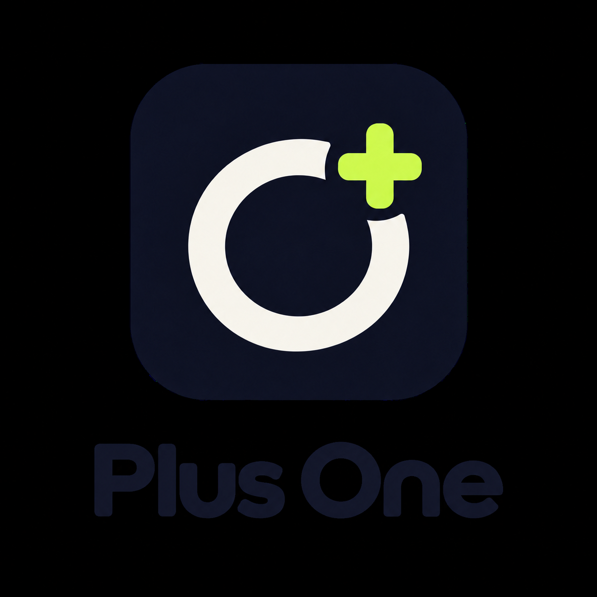

<p align="center">
  
</p>

# Plus One

Plus One — учебное веб-приложение, которое собирает в одном месте скидки, акции и специальные предложения для студентов.

## Проблема

Студенческие предложения публикуются на разных сайтах и часто остаются незамеченными. Plus One показывает их в едином каталоге и позволяет быстро отфильтровать предложения по категории.

## Что реализовано

- публичная стартовая страница;
- каталог предложений по адресу `/offers`;
- отдельная внутренняя страница каждого предложения;
- административная страница управления предложениями по адресу `/admin/offers`;
- хранение предложений в локальной базе SQLite;
- загрузка предложений через ASP.NET Core Web API;
- создание, редактирование и удаление предложений через API и административный интерфейс;
- поиск в административном разделе по названию предложения и компании;
- автоматическое скрытие истёкших предложений из публичного каталога;
- отметка активных и истёкших предложений в административном разделе;
- карточки с компанией, описанием, категорией, источником и сроком действия;
- промокоды с инструкцией по использованию и кнопкой копирования;
- фильтрация предложений по категории без повторного запроса к API;
- состояния загрузки, пустого списка и ошибки API;
- адаптивный интерфейс для компьютеров и мобильных устройств;
- регистрация и вход для обычных пользователей;
- роли `User` и `Admin`: зарегистрированному пользователю назначается роль `User`;
- доступ к созданию, редактированию и удалению предложений только для роли `Admin`;
- Swagger для просмотра API в режиме разработки;
- GitHub Actions для сборки Pull Request в `main`.

При первом запуске API автоматически создаёт локальную базу `plusone.db` и добавляет в неё демонстрационные предложения. Файл базы не добавляется в Git.

## Технологии

- .NET 10;
- ASP.NET Core Web API;
- Blazor WebAssembly;
- Entity Framework Core;
- SQLite;
- Swagger / OpenAPI;
- GitHub Actions.

## Архитектура

```text
Blazor WebAssembly
        │
        │ /auth, /register, GET, POST, PUT, DELETE /api/offers
        ▼
ASP.NET Core Web API
        │
        ▼
Entity Framework Core
        │
        ▼
SQLite (`plusone.db`)
```

Общие модели запросов и ответов находятся в проекте `PlusOne.Contracts` и используются frontend и backend.

## Структура репозитория

```text
src/
├── PlusOne.Api/         # Web API, EF Core и доступ к SQLite
├── PlusOne.Contracts/   # Общие DTO и перечисления
└── PlusOne.Web/         # Blazor WebAssembly приложение
docs/
└── design/              # Макеты каталога
```

## Локальный запуск

### Требования

- .NET SDK 10.0 или новее в пределах версии 10;
- Rider 2025.3+ или другой редактор с поддержкой .NET 10.

Проверить установленную версию SDK:

```bash
dotnet --version
```

### 1. Восстановить зависимости и собрать решение

Из корня репозитория выполнить:

```bash
dotnet restore PlusOne.sln
dotnet build PlusOne.sln --no-restore
```

### 2. Запустить API

В первом терминале:

```bash
dotnet run --project src/PlusOne.Api --launch-profile http
```

API будет доступен по адресу `http://localhost:5147`. Swagger: `http://localhost:5147/swagger`.

При первом запуске API создаются две роли и учебная учётная запись администратора:

```text
Логин: admin
Пароль: admin123
```

Эти данные предназначены только для локальной демонстрации. Перед размещением приложения в интернете пароль необходимо заменить, а способ авторизации — усилить.

### 3. Запустить frontend

Во втором терминале:

```bash
dotnet run --project src/PlusOne.Web --launch-profile http
```

Открыть `http://localhost:5112`. Каталог находится по адресу `http://localhost:5112/offers`, управление предложениями — по адресу `http://localhost:5112/admin/offers`.

Новый пользователь может зарегистрироваться на странице `http://localhost:5112/registration`, затем войти на странице `http://localhost:5112/login`.

Оба приложения должны работать одновременно: frontend получает предложения с API.

## Запуск в Rider

1. Открыть файл `PlusOne.sln`.
2. Дождаться восстановления NuGet-пакетов.
3. Запустить проект `PlusOne.Api` с профилем `http`.
4. Запустить проект `PlusOne.Web` с профилем `http`.
5. Открыть `http://localhost:5112`.

## Проверка

API можно проверить вручную после запуска backend:

```bash
curl http://localhost:5147/health
curl http://localhost:5147/api/offers
curl "http://localhost:5147/api/offers?search=Яндекс"
curl "http://localhost:5147/api/offers?includeExpired=true"
```

Публичный запрос `GET /api/offers` не возвращает предложения с прошедшим сроком действия. Параметр `includeExpired=true` предназначен для административного интерфейса и включает такие записи в ответ.

## Команда

| Участник | Роль в проекте |
| --- | --- |
| Айдар | Product Owner, backend-разработка |
| Рэдик | Backend Developer |
| Артур | Frontend Developer |
| Дамир | Scrum Master, Backend Developer, Team Lead |
| Назар | UI/UX Design, frontend-разработка |
| Камиль | Презентация, маркетинг, frontend-разработка |

## Статус проекта

Первый MVP-инкремент реализован: пользователь может открыть каталог, получить актуальные предложения из API, отфильтровать их по категории и открыть промокод с инструкцией по использованию. Через страницу `/admin/offers` можно создавать, искать, редактировать и удалять предложения.

В текущем спринте используются демонстрационные данные, которые сохраняются в локальной базе SQLite. Регистрация и вход реализованы для учебного локального MVP: состояние пользователя хранится только до обновления страницы, а API проверяет роль по `userId`. Такой подход не защищает от подмены идентификатора и не подходит для опубликованного приложения.

В будущих спринтах должны появиться полноценная защита сессии, безопасное разграничение прав, личный кабинет, кабинет партнёра и автоматический сбор предложений. Эти возможности пока не считаются частью готового продукта.

## Работа с репозиторием

Изменения вносятся в отдельных feature-ветках и попадают в `main` только через Pull Request после проверки сборки и review.
